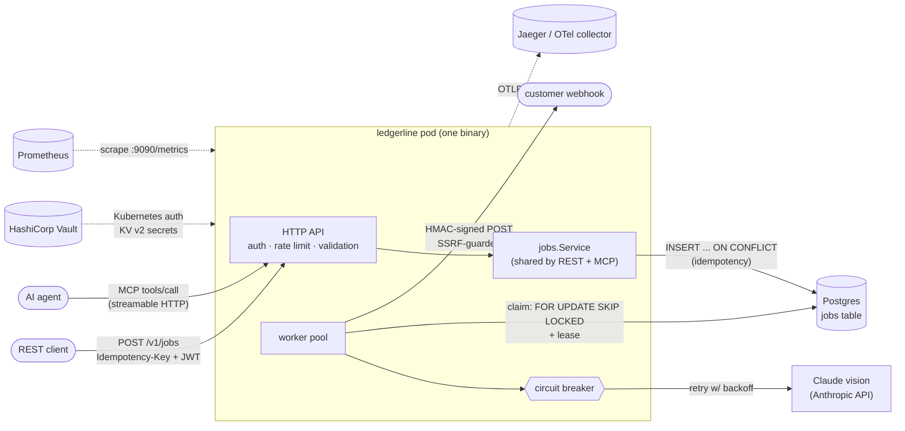
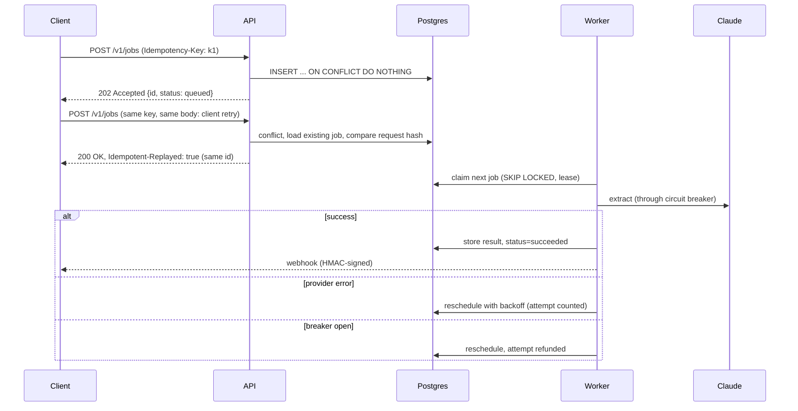

# ledgerline

[](https://github.com/iAscen/ledgerline/actions/workflows/ci.yml)

**Live demo: <https://ledgerline-demo.fly.dev>**: upload a receipt (or use the built-in sample), watch the async job, resend it to see idempotency, and simulate a provider outage to see the circuit breaker open. Demo mode uses a simulated extractor, so results are realistic but made up.

A production-style Go microservice that turns photos and PDFs of receipts into
structured data (merchant, date, GST/QST and other taxes, totals, line items)
using Claude vision, behind an asynchronous, idempotent, rate-limited REST API
and an MCP endpoint for AI agents.

It re-implements, from scratch and in Go, the extraction pattern I built for
my TaxAi product. The goal of this repository is to show the engineering
around a model call: everything that has to be true for it to be safe to run
in production.

| | |
|---|---|
| **Go** | Go 1.26, `net/http` routing, `slog`, pgx + sqlc, goose migrations, no web framework |
| **API** | Interactive demo page at `/`, OpenAPI 3.1 ([`api/openapi.yaml`](api/openapi.yaml)), JWT auth with scopes, `Idempotency-Key`, RFC 9457 errors, per-tenant rate limits |
| **Async pipeline** | Postgres-backed queue (`FOR UPDATE SKIP LOCKED`, leases), retries with exponential backoff + jitter, circuit breaker, signed webhooks |
| **AI** | Claude vision via the official Anthropic Go SDK with structured JSON output; MCP server (official Go SDK) exposing the same use cases as tools |
| **Kubernetes** | Helm chart (Deployment, Service, HPA, PDB, ConfigMap, ServiceAccount, probes, limits, hardened security context), kind cluster |
| **Secrets** | HashiCorp Vault with Kubernetes auth (official Vault Helm chart in kind), env-var fallback |
| **Observability** | OpenTelemetry traces (request → job → provider → webhook, one trace), Prometheus RED + domain metrics, trace IDs in logs, [SLOs](docs/SLO.md), [runbook](docs/RUNBOOK.md) |
| **CI/CD** | GitHub Actions: golangci-lint, sqlc drift check, `go test -race` incl. Postgres via testcontainers, govulncheck, Trivy (image + manifests), GHCR push, `helm lint` + chart-testing, kind end-to-end test |

## Architecture





## Design decisions

**Asynchronous by default.** Vision extraction takes seconds and depends on a
third party. Accepting a job is one indexed `INSERT`, so the API's latency and
availability SLOs ([SLO.md](docs/SLO.md)) depend only on this service and its
database, never on the model provider.

**Postgres as the queue.** `FOR UPDATE SKIP LOCKED` lets any number of replicas
pull work without double-processing, and a lease (`locked_until`) means a job
held by a crashed pod is picked up again automatically. It removes a moving
part (no Kafka/RabbitMQ/Redis) at this scale, and job state and the queue can
never disagree because they are the same row. Past a few thousand jobs per
second I would move to a dedicated broker.

**Idempotency is enforced by the database, not by a check-then-insert.**
`INSERT ... ON CONFLICT (tenant, idempotency_key) DO NOTHING` is atomic, so 20
concurrent retries of one request create exactly one job (there is a test for
exactly that). The request body is hashed so a reused key with a *different*
body is rejected with `422` instead of silently returning an unrelated job.
MCP tool calls default the key to a hash of the document, so an agent that
retries never duplicates work.

**What the circuit breaker counts.** Only provider-side faults (5xx, 529
overloaded, 429, timeouts, auth failures) count toward opening it. A bad
document is the caller's problem and fails the job immediately without
touching the breaker. While the breaker is open, jobs are rescheduled with
their attempt refunded, since the provider was never called. The SDK's own
retries are disabled so the breaker sees real failures instead of hidden ones.

**Readiness does not depend on the provider.** `/readyz` checks Postgres but
only *reports* the breaker. If it failed readiness, a Claude outage would pull
every pod out of the Service and turn "extractions are delayed" into "the API
is down".

**Secrets from Vault with Kubernetes auth.** Pods authenticate with their
projected service account token; a Vault role bound to exactly one service
account and namespace grants read on exactly one KV path. No secret is ever in
a manifest, values file, image or CI variable. The same keys fall back to
`LEDGERLINE_*` env vars for compose and Fly.io; in-cluster the fallback is
disabled (`vault.required=true`) so a Vault problem fails loudly.

**Money is integers.** All amounts are minor units (cents), straight from the
model's structured output schema. Taxes are a list (GST/TPS and QST/TVQ on a
Québec receipt, HST elsewhere), not two hard-coded fields.

**Webhooks are an attack surface.** URLs are user-supplied, so the sender
refuses private, loopback, link-local and CGNAT addresses *at connect time,
after DNS resolution*, which also defeats DNS rebinding. Redirects are not
followed. Payloads are signed `HMAC-SHA256("<timestamp>.<body>")` so receivers
can verify origin and reject replays.

**One binary, two roles.** API and workers run in the same process and scale
together through one HPA. Splitting them into two Deployments is a values
change if their load profiles diverge.

**Store contract tests.** The in-memory store (used by unit tests and the
free public demo) and the Postgres store run the *same* test suite, the
latter against a real Postgres 17 in a testcontainer, so the fake cannot drift
from production behaviour.

**Known trade-offs.** Rate limits are per pod (N replicas give N× the
configured rate; Redis would make them global). A pod that dies between saving
a result and delivering its webhook skips that delivery; a transactional
outbox would make delivery guaranteed. Documents are stored in Postgres for
simplicity; object storage with a reference would be the production choice.

## Running it

### Locally with Docker Compose (Postgres + Jaeger)

```bash
docker compose up --build -d
BASE_URL=http://localhost:8080 CHECK_BREAKER=1 scripts/smoke.sh
```

* **Interactive demo page: <http://localhost:8080>** (upload a receipt, watch the job, simulate an outage)
* OpenAPI: <http://localhost:8080/openapi.yaml>
* Metrics: <http://localhost:9090/metrics> · Traces: <http://localhost:16686>

By default the **fake provider** is used: deterministic results, no API key, no
cost. To extract real receipts with Claude:

```bash
ANTHROPIC_API_KEY=sk-ant-... LEDGERLINE_PROVIDER=anthropic docker compose up --build -d
```

### Try the API

```bash
TOKEN=$(make -s token)        # or: curl -X POST localhost:8080/v1/demo/token
DOC=$(base64 -w0 receipt.jpg)

# Submit (run it twice: same job id, second answer is a replay)
curl -s localhost:8080/v1/jobs -H "Authorization: Bearer $TOKEN" \
  -H "Idempotency-Key: receipt-2026-001" -H 'Content-Type: application/json' \
  -d "{\"document_base64\":\"$DOC\",\"media_type\":\"image/jpeg\"}"

curl -s localhost:8080/v1/jobs/<id> -H "Authorization: Bearer $TOKEN"
```

```json
{
  "id": "0b6f…", "status": "succeeded", "attempts": 1,
  "result": {
    "merchant": "Café Olimpico", "date": "2026-03-14", "currency": "CAD",
    "subtotal_minor": 1250,
    "taxes": [{"name": "GST", "amount_minor": 63}, {"name": "QST", "amount_minor": 125}],
    "total_minor": 1438, "category": "meals", "confidence": 0.97, "…": "…"
  }
}
```

**Forcing failures.** With the fake provider, a document containing
`LEDGERLINE_FAIL` fails transiently once (counts toward the breaker) and then
permanently on any retry, and `LEDGERLINE_REJECT` fails permanently. The
"once" matters on the shared public demo: test documents that kept failing
would win the breaker's half-open probes and hold it open for minutes, stalling
other visitors' receipts. This way the first probe gets an answer and the
breaker closes about one open timeout after a test. `CHECK_BREAKER=1 scripts/smoke.sh`
uses this to open the breaker and checks that `/v1/status` reports it while
`/readyz` stays green.

### MCP (AI agents)

`/mcp` speaks the MCP streamable-HTTP transport with the same bearer token.
Tools: `extract_receipt` (optionally waits for the result), `get_job`,
`list_jobs`. For example, in an MCP client config:

```json
{
  "mcpServers": {
    "ledgerline": {
      "type": "http",
      "url": "http://localhost:8080/mcp",
      "headers": { "Authorization": "Bearer <token>" }
    }
  }
}
```

### Kubernetes with kind (Helm + Vault)

Needs Docker, [kind](https://kind.sigs.k8s.io), kubectl and Helm.

```bash
make kind-up   # 3-node cluster, Postgres, Vault (official chart, dev mode) + Kubernetes auth
make deploy    # build image, kind load, helm upgrade --install, helm test
make e2e       # port-forward the Service, assert secrets came from Vault, run the smoke test
make kind-down
```

`kind-up` configures Vault with a KV v2 secret, a read-only policy for that
one path, and a Kubernetes auth role bound to the `ledgerline` service
account ([`scripts/vault-setup.sh`](scripts/vault-setup.sh)).

> **Honest scope:** Kubernetes support is proven with kind, locally and on
> every CI run (the `e2e-kind` job installs Vault and the chart and runs the
> smoke test through the Service). The chart is written for a managed cluster
> (AKS/EKS/GKE), but this repository has not been run on one. Things kind
> does not exercise: the HPA (kind ships no metrics-server, so it shows
> `<unknown>` targets), cloud load balancers, and a production Vault (HA Raft,
> auto-unseal).

### Fly.io (public demo)

```bash
fly launch --no-deploy --copy-config      # choose an app name (the live demo is ledgerline-demo, region yyz)
fly secrets set LEDGERLINE_JWT_SECRET=$(openssl rand -hex 32) LEDGERLINE_WEBHOOK_SECRET=$(openssl rand -hex 32)
fly deploy
BASE_URL=https://<app>.fly.dev scripts/smoke.sh
```

Visitors open `https://<app>.fly.dev/` and get the interactive demo page: drop
in a receipt (or draw a sample one in the browser), watch it go
queued → processing → succeeded, resend it to see the idempotency key return
the same job, and press "Simulate provider outage" to watch the circuit breaker
open while `/readyz` stays green. The page is one self-contained HTML file
embedded in the binary (no external scripts, strict CSP).

The demo runs the in-memory store and the fake provider, so it costs one small
machine and never spends API credits. `GET /v1/status` is public and
CORS-enabled for a status widget; `POST /v1/demo/token` hands out 15-minute
tokens for throwaway tenants (rate limited per IP; off unless
`LEDGERLINE_PUBLIC_DEMO=true`).

## Configuration

All settings are `LEDGERLINE_*` environment variables
([`internal/config`](internal/config/config.go)). The important ones:

| Variable | Default | |
|---|---|---|
| `STORE` | `postgres` if a DB URL or Vault is set, else `memory` | `postgres` \| `memory` |
| `PROVIDER` | `fake` | `fake` \| `anthropic` |
| `ANTHROPIC_MODEL` | `claude-opus-5-5` | |
| `WORKER_CONCURRENCY` | `4` | jobs in flight per pod |
| `MAX_ATTEMPTS` | `5` | before a job fails permanently |
| `BREAKER_THRESHOLD` / `BREAKER_OPEN_TIMEOUT` | `5` / `30s` | |
| `RATE_LIMIT_RPS` / `RATE_LIMIT_BURST` | `5` / `10` | per tenant |
| `VAULT_ADDR`, `VAULT_ROLE`, `VAULT_KV_PATH` | unset, `ledgerline`, `ledgerline` | enables Vault |
| `SHUTDOWN_TIMEOUT` / `READINESS_DRAIN` | `25s` / `5s` | graceful shutdown |

Secrets (Vault fields, or env fallback `LEDGERLINE_<NAME>`): `jwt_secret`,
`database_url`, `webhook_secret`, `anthropic_api_key`.

## Development

```bash
make test        # go test -race ./... (Postgres contract runs if Docker is up)
make lint        # golangci-lint v2
make vuln        # govulncheck
make generate    # sqlc generate (queries live in internal/store/queries)
make helm-lint
```

```
cmd/ledgerline        entrypoint: serve | migrate | token | healthcheck
api/                  OpenAPI 3.1 spec (embedded and served at /openapi.yaml)
internal/app          composition root + graceful shutdown
internal/httpapi      routing, middleware (auth, rate limit, metrics, CORS), handlers
internal/mcpserver    MCP tools over the official Go SDK
internal/jobs         application service shared by REST and MCP
internal/worker       claim → extract → store → webhook
internal/extract      Provider interface, Claude implementation, fake
internal/resilience   circuit breaker, backoff
internal/store        Store interface, Postgres (sqlc) + memory, contract tests
internal/secrets      Vault (Kubernetes auth, KV v2) with env fallback
internal/telemetry    Prometheus metrics, OpenTelemetry tracing, trace-aware slog
charts/ledgerline     Helm chart
deploy/kind           kind cluster, demo Postgres, Vault values
docs/                 SLOs and runbook
```

## License

MIT
